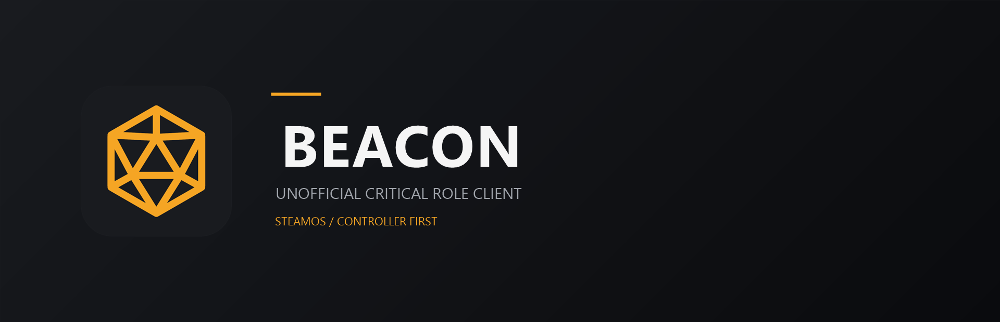

# Beacon for Linux (Unofficial)



An unofficial, controller-first Beacon (Critical Role) client for Linux and SteamOS.

Launch it from Steam Game Mode and drive the whole thing with a Steam Controller:
browse, search, resume, watch — the way [VacuumTube](https://github.com/shy1132/VacuumTube)
does for YouTube.

> **Unofficial.** Not made by, affiliated with or endorsed by Critical Role or Beacon.
> It talks to Beacon's private API with your own account. Beacon can change or block
> it at any time, and using it may be against Beacon's terms. No content is
> redistributed and no paywall or DRM is bypassed — playback uses the same non-DRM
> HLS streams Beacon serves its own TV clients.

## Install

The AppImage is the only published build. It installs under your home folder,
and SteamOS system updates leave it alone.

### SteamOS and Steam Deck

In Desktop Mode, with Steam running:

```sh
curl -fsSL https://github.com/Winde/beacon-linux/releases/latest/download/install.sh | bash
```

Prefer to read it first:

```sh
curl -fsSLO https://github.com/Winde/beacon-linux/releases/latest/download/install.sh
less install.sh
bash install.sh
```

The installer downloads and verifies the AppImage, installs it to
`~/Applications/Beacon.AppImage`, adds a Steam shortcut, and applies the library
artwork. `--no-steam` installs without the shortcut, `--version vX.Y.Z` pins a
release, `--force-art` replaces artwork you changed in Steam, and `--uninstall`
removes the local files. The full guide, including the manual steps and
troubleshooting, is [docs/install-steamos.md](docs/install-steamos.md).

The installer and the artwork are separate release assets; the AppImage stays a
single self-contained file.

### Controller layout (one-time)

Beacon reads the controller through the Gamepad API, so the Steam shortcut must
use a layout that presents the pad as a gamepad. The installer adds the shortcut
but cannot choose this for you:

1. In Steam, open **Beacon → Properties → Controller**.
2. Pick **Gamepad** or **Gamepad with Joystick Trackpad**.
3. Leave **Enable the Steam Overlay while in-game** on; the on-screen keyboard
   depends on it.

Then launch Beacon from Game Mode. See
[docs/steam-input.md](docs/steam-input.md#the-layout-the-app-expects) for what
each layout maps to.

### Updates

Beacon updates itself from inside the app. **Check for updates** at the foot of
the left menu compares this build with the latest GitHub release; if one is
newer, `Update now` downloads it beside the running AppImage, verifies it against
the release's `SHA256SUMS.txt` and restarts into it. Nothing installs on its own.
Builds before 0.2.0 have no updater, so upgrade those once with the installer;
after that the menu keeps the app current.

The installer is the fallback: re-run it for a first install, a machine without
write access to the AppImage, or to repair one. It reuses the existing shortcut
and leaves its name, layout and any artwork you changed in Steam alone.

### Other Linux distributions

The same AppImage runs on other glibc-based distributions, and the installer
works there too as long as Steam is installed, giving you the shortcut and the
artwork. Without Steam, download `Beacon-<version>-x86_64.AppImage` from
[Releases](https://github.com/Winde/beacon-linux/releases), make it executable
and run it. FUSE 2 is the only system dependency; where it is missing,
`--appimage-extract-and-run` works without it. Adding it to Steam is what gives
you Game Mode, the controller layout and the on-screen keyboard.

### From source

Requires Node.js 22.12 or newer (Vitest 5 needs it; CI uses Node 22).

```bash
npm install
npm run dev
```

The first launch shows the sign-in screen. Free videos work without an account.
The window opens fullscreen and zooms the page to the display, so a TV shows the
same layout at its own resolution rather than a scaled-up, pixelated one; `F11`
leaves fullscreen. On a Steam Deck, `STEAM` + `X` opens the on-screen keyboard
for the password field.

Build, test and release commands are under [Development](#development).

## Status

Working end to end: sign-in, home, browse, series, episode pages, search, favourites,
and video playback with resume, progress sync and next-episode autoplay. Verified on
SteamOS in Game Mode with a real Steam Controller, using one of the layouts under
[Controller layout](#controller-layout-one-time). Watch progress is flushed when
the machine suspends.

Verified against the live service on 2026-11-17.

## Controls

| Action | Gamepad | Keyboard |
|---|---|---|
| Move | D-pad / left stick | Arrow keys |
| Select | A | Enter |
| Back | B / Back | Escape |
| Search | left on the edge | `/` |
| Play / pause | A | Space |
| Seek ±10s | D-pad left / right | ← / → |
| Seek ±1min | LT / RT | — |
| Player controls | D-pad up / down, Y / Start | ↑ / ↓, M |
| Scrub while paused | ↑ then ← / →, A to jump, A again to play | ↑ then ← / →, Enter to jump, Enter again to play |
| Choose in a player menu | D-pad + A | Arrows + Enter |
| Ending card (last 15s) | A plays next, B keeps watching | Enter / Escape |
| Quit | B on the first screen | Ctrl+Q |
| Fullscreen | — | F11 |

These assume the **Gamepad** or **Gamepad with Joystick Trackpad** layout from
[Controller layout](#controller-layout-one-time). B on Home exits the app; the
rail's Sign out asks for confirmation first.

In the player, ↑/↓ (or Y/Start) reaches the controls, where ←/→ moves between
them. While the bar is unfocused, ←/→ seek. When paused, ↑ goes instead to the
progress bar: ←/→ move the seek marker and A/Enter jumps to that time. Press
A/Enter again without moving the marker to play from there. ↓ leaves the
scrubber for the controls. The bar has subtitles, audio track, quality, playback
speed and fullscreen; a chosen subtitle language is remembered for the next
video.

## How it works

Beacon's TV clients ask for streams with `x-supports-drm: false` and get back plain
HLS from JW Player — no Widevine. That makes a native client straightforward. See
[docs/beacon-api.md](docs/beacon-api.md) for the full API reference.

```
┌─────────────────────────────── Electron ───────────────────────────────┐
│  main process                                                          │
│    BeaconClient   Memberful OAuth, GraphQL, watch progress             │
│    Catalog        local index of ~1,300 videos, fuzzy search           │
│    favourites.ts  Beacon favourites, hydrated from the catalog         │
│    hls.ts         master playlist reordered best-first                 │
│    updates.ts     GitHub releases, verified AppImage swap              │
│                          │ IPC                                          │
│  renderer (React)        ▼                                             │
│    focus engine   spatial navigation from d-pad / stick / arrows       │
│    screens        login, home, browse, series, episode, search, player │
│    hls.js         plays the reordered playlist                         │
└────────────────────────────────────────────────────────────────────────┘
```

What happens between launch and the first usable screen, and where that time
goes, is in [docs/startup.md](docs/startup.md).

### Home

Home is Beacon's own editorial page: `MemberHomePage.pageContent` supplies the
hero and the shelves — Featured, Continue watching, Watch by Series, Latest
Videos — in the order the editors set. Blocks the client cannot use on a TV
(articles, audio for now) are filtered out, `excludedPlatforms` is honoured per
block, and a block the client has no fragment for is skipped without taking the
page down.

### Browse

Browse lists every series and collection in the index, split into the two tabs
Beacon files them under. Both open on **Newest**, ordered by the collection's
release date from Beacon, and the sort row switches to **Oldest**, **A-Z** or
**Z-A**.

### Favourites

Favourites are Beacon's, not ours. Series and collections can be favourited
from the hero on Home or from their own page, and a **Favourites** row appears
on Home just below *Continue watching* by default. The arrows in that row's
heading move it among the shelves; the row remembers which shelf it follows
(`preferences.json`), so editorial changes to the home do not shift it. That
anchor is the only part kept on the device, because it is a layout choice and
not account data.

The list itself comes from `userCollectionFavourites` and is written back with
`toggleCollectionFavouriteEndpoint`, so it is the same list beacon.tv and the
official apps show. The control flips as soon as it is pressed and shows a
spinner until the account confirms the write; a refused write puts it back.
Items are hydrated from the local catalog index each launch, which keeps titles
and artwork current. Nothing is cached for an offline session: with no account,
or no network, there is no favourites row.

Beacon also records a favourite on individual videos. This client only surfaces
series and collection favourites today, so an episode page offers no button;
favourite the series instead. Signing out leaves the account's favourites
untouched.

### Sessions and storage

API calls live in the main process for two reasons: Beacon's CMS only accepts
`beacon.tv` as a browser origin (so the renderer would be blocked by CORS), and
tokens stay out of the renderer. The session is encrypted at rest with the OS
keyring via Electron's `safeStorage` when one is reachable. SteamOS Game Mode
has no keyring, so there it falls back to safeStorage's `basic_text` backend:
the session is saved and you stay signed in, but the key is one baked into
Chromium, so the file is obfuscated rather than protected. The sign-in screen
says which case you are in.

## Roadmap

- [ ] Live-event support (Beacon's waiting room)

## Development

### Build

```bash
npm run build          # compile
npm run build:linux    # AppImage (run on Linux or CI)
```

### Test

```bash
npm test               # unit tests (Vitest)
npm run test:watch     # re-run on change
npm run lint           # ESLint
npm run format:check   # Prettier
npm run typecheck      # type-check app and tests
npm run verify         # all four checks, in order
```

Tests sit next to the code they cover (`*.test.ts` / `*.test.tsx`). Most run in
Node; files that need the DOM start with `// @vitest-environment jsdom`.
Component and screen tests use Testing Library (`@testing-library/react`).
Every push to `main` and every pull request runs lint, format, typecheck, tests
and a production build in [`.github/workflows/ci.yml`](.github/workflows/ci.yml).

`typescript` is aliased to `@typescript/typescript6` because typescript-eslint
still needs the TypeScript 6 API. `@typescript/native` supplies the TypeScript 7
`tsc` that `npm run typecheck` uses; nothing else changed.

### Releases

A release is a tag. Pushing a `vMAJOR.MINOR.PATCH` tag builds and tests the
commit, writes the notes from the commits since the previous release, and
publishes a release named after the tag with the AppImage, `install.sh`,
`steam-art.zip` and `SHA256SUMS.txt`. Nothing is created by hand. The workflow
can also be run with `dry_run` on any commit to build and test everything
without touching a release. See [docs/releasing.md](docs/releasing.md) for the
notes rules, versioning and the checklist.

### Dev helpers

`BEACON_OPEN=<slug>` opens a video or series directly. `BEACON_SHOT=<path>` renders
the app, saves a PNG of the page and quits — useful for checking layout without a
second monitor. `BEACON_SHOT_SCRIPT` runs JavaScript before the capture, and
`BEACON_SHOT_DELAY` / `BEACON_SHOT_SETTLE` control the timing.

## Legal

This project is unofficial and unaffiliated. Beacon and Critical Role are
trademarks of Critical Role Productions LLC.

It is a client, not a mirror. It talks to Beacon's own API using your own
account, and plays the same non-DRM HLS streams Beacon serves its own TV clients.
It does not redistribute, re-host, or circumvent access to any content, and it
bundles no Beacon artwork, logos, or media — titles, images and video are loaded
at runtime from Beacon's servers and remain the property of their owners.

Beacon's API is private and undocumented. Using it may be against Beacon's terms
of service, and it can change or be blocked at any time.

See [ACKNOWLEDGEMENTS.md](ACKNOWLEDGEMENTS.md) for third-party credits.

## License

MIT for this project's own code. See [LICENSE](LICENSE).
